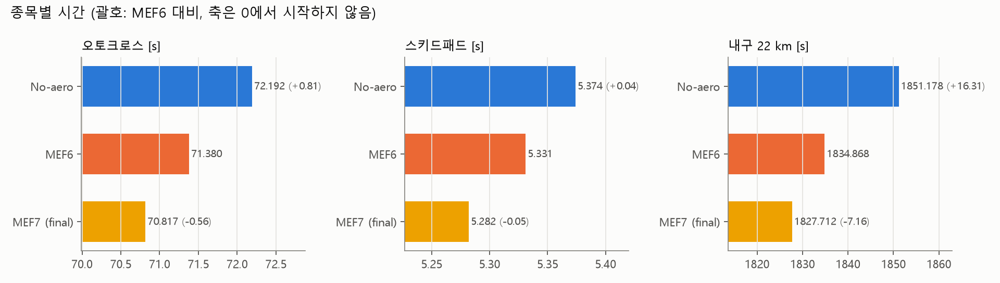
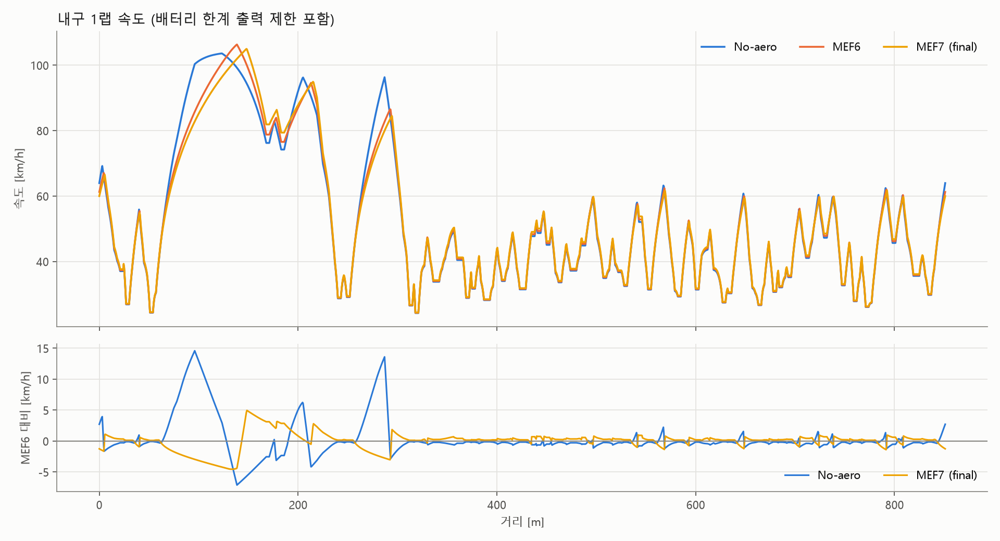
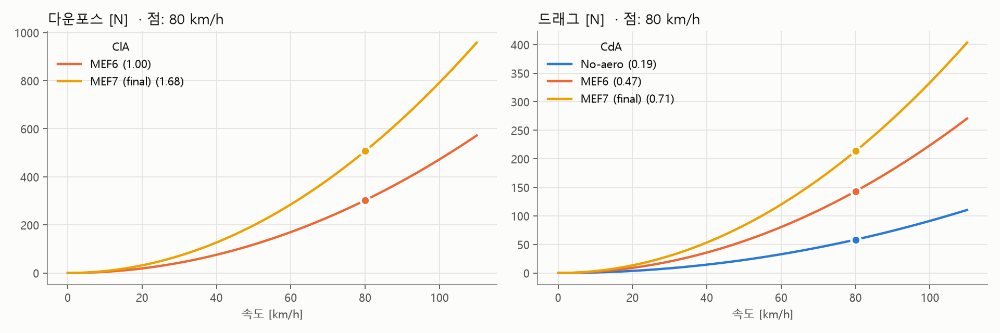
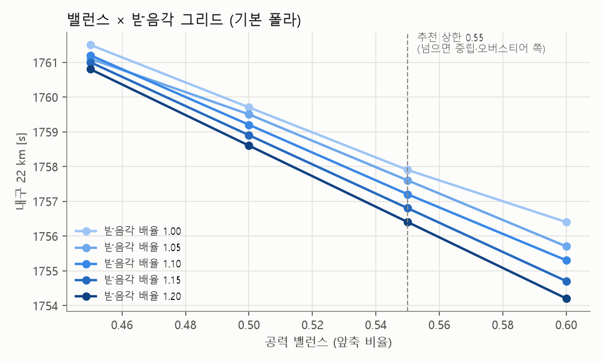
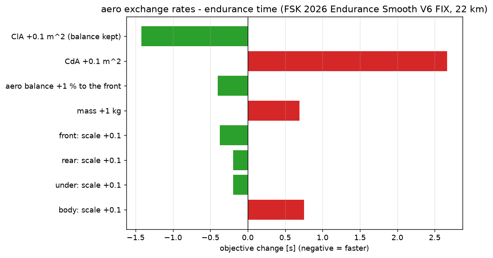

# MEF7 공력 목표 — MIP 228MV FD4 차량, FSK 2026 V6 FIXED 트랙

OptimumLap 설계 파일(`data/vehicles/MIP_228MV_FD4_Diagnostic.OLVeh`, `data/tracks/FSK2026_GiantCorners_Smoothed_V6_FIXED_851m.OLTra`)에
공력 파츠 값만 바꿔 넣고 랩타임을 비교했습니다. **공력 외 파라미터(질량·배터리·출력·서스펜션·타이어)는 바꾸지 않았습니다.**

| 이름 | 뜻 |
|---|---|
| No-aero | 윙 없음 (차체·타이어 CdA 0.193만, 302 kg) |
| MEF6 | 2026 차 (OptimumLap 파일 값 ClA 1.00 / CdA 0.473, 310 kg) |
| MEF7 (final) | 이 문서의 최종 설정 (ClA 1.68 / CdA 0.706, 밸런스 0.55, 310.6 kg) |

## 1. 결과

AeroLap L4(4륜 하중이동·공력 밸런스·롤/요), 내구는 배터리 7.48 kWh 한계(출력 제한 포함).

| 패키지 | 가속 75 m | 스키드패드 | 오토크로스 | 내구 22 km | 내구 출력 상한 |
|---|---|---|---|---|---|
| No-aero | 4.006 s | 4.996 s | 68.818 s | 1766.9 s | 제한 없음 |
| MEF6 | 3.995 s | 4.950 s | 68.055 s | 1763.2 s | 43.3 kW |
| **MEF7 (final)** | 4.002 s | **4.899 s** | **67.445 s** | **1757.2 s** | 39.8 kW |
| MEF7 − MEF6 | +0.007 | −0.051 | **−0.610** | **−6.0** | |

OptimumLap 동등(L0, 점질량 — 밸런스·배터리 없음, ClA·CdA만 다름). OptimumLap에 `cl`, `cd`를 넣어 그대로 재현할 수 있습니다
(전면 면적 0.635 m²):

| 패키지 | ClA / CdA | OptimumLap cl / cd | 1랩 |
|---|---|---|---|
| No-aero | 0 / 0.193 | 0 / 0.304 | 67.902 s |
| MEF6 | 1.00 / 0.473 | 1.575 / 0.745 | 67.054 s |
| **MEF7 (final)** | 1.68 / 0.706 | **2.639 / 1.111** | **66.498 s (−0.556)** |




## 2. MEF7 (final) 공력 값

| 파츠 | ClA | CdA |
|---|---|---|
| 프론트윙 | 0.89 | 0.238 |
| 리어윙 (하단 윙 포함) | 0.94 | 0.275 |
| 차체·타이어 | −0.15 | 0.193 |
| **합계** | **1.68** | **0.706** (보수적 폴라 0.721) |
| 공력 밸런스 (앞축) | 0.55 | |

| 속도 | 다운포스 | 드래그 | 앞축 / 뒤축 다운포스 |
|---|---|---|---|
| 40 km/h | 127 N | 53 N | 70 / 57 N |
| 60 km/h | 285 N | 120 N | 157 / 128 N |
| 80 km/h | 507 N | 214 N | 279 / 228 N |
| 100 km/h | 792 N | 334 N | 436 / 356 N |



## 3. 값을 찾은 방법

1. **파츠 폴라** (`scripts/aero_optimize.py`): 현실 목표 파츠 예산(프론트 0.81/0.209, 리어 0.52/0.139, 하단 0.33/0.108, 차체 −0.15/0.193)을
   배율 1로 두고, 받음각 배율 s에 대해 `ClA = ClA0·s`(실속 후 감소), `CdA = CdA0·(p + (1−p)·s²)`(유도항력).
   기본 폴라 p = 0.35(윙)·0.60(하단), 실속 s = 1.3 / 보수적 폴라 p = 0.20·0.40, 실속 s = 1.15.
2. **최적화** (받음각 배율 3개 + 밸런스, 언더스티어 지수 1.0–1.3 제약): 기본 폴라에서는 실속 직전(s = 1.3)으로 가지만 보수적 폴라에서 손해 →
   폴라 가정에 기대는 답이라 쓰지 않음.
3. **강건성 그리드** (`--grid`, 두 폴라 모두): 밸런스 효과는 폴라와 무관하고(0.45 → 0.55에서 내구 −3.6 s), 받음각 배율 1.10–1.15가
   두 폴라에서 모두 이득. 1.20부터 보수적 폴라에서 손해. → **s = 1.10, 밸런스 0.55**.
   이전 트랙(15 m 평활화 콘맵)에서도 같은 값이 최적이었습니다(MEF6 대비 내구 −4.4 s).



**교환비** (`aerolap aero-exchange`, 배터리 한계 내구):

| 변화 | MEF6 | MEF7 (final) |
|---|---|---|
| ClA +0.1 (밸런스 유지) | −1.26 s | −1.42 s |
| CdA +0.1 | +2.34 s | +2.67 s |
| 밸런스 +1 % 앞으로 | −0.22 s | −0.40 s |
| 질량 +1 kg | +0.58 s | +0.69 s |
| 손익분기 L/D (추가 다운포스) | 1.86 | 1.88 |



## 4. 한계 (보고서에 함께 적을 것)

- **밸런스 0.55가 상한**: 0.60이면 내구가 1.9 s 더 빠르지만 언더스티어 지수 1.04(거의 중립). 준정적 모델이라 과도 안정성은 보지 못함.
  정적 무게배분(앞 50 %)보다 앞이므로 실차 테스트로 확인.
- **폴라 형상은 가정값** — CFD 받음각 2–3점을 `points: [[scale, ClA, CdA], ...]`로 넣으면 대체됨.
- 가속은 MEF6보다 0.007 s 느림(드래그·앞 밸런스로 후륜 하중 감소). 영향 미미.
- 무게중심·서스펜션·배터리(132S4P)는 `fsk2026.yaml`의 가정값 그대로.

## 5. 재현

```bash
cd packages/aerolap
export AERO_VEHICLE=data/vehicles/mip_228mv_fd4.yaml AERO_TRACK=data/tracks/fsk2026_v6_fixed.csv AERO_OUT=aero_targets_v6
python scripts/aero_targets.py                                  # 패키지 비교 (~1 분)
python scripts/aero_optimize.py --grid | tee out/aero_targets_v6/grid_log.txt   # 강건성 그리드 (~3 분)
python scripts/aero_report_plots.py                             # MEF7 실행, 그래프, aerolap run / aero-exchange, L0 (~2 분)
```

PDF 보고서: [reports/MEF7_report.pdf](reports/MEF7_report.pdf) (`python scripts/mef7_report_pdf.py`, MEF7만).

결과: `out/aero_targets_v6/` (`summary.txt`, `optimumlap_L0.txt`, 패키지별 `events.txt`·`trace_*.csv`, `figures/`).
트랙·차량 변환: `aerolap import-track ...V6_FIXED_851m.OLTra --out data/tracks/fsk2026_v6_fixed.csv`,
`aerolap import-vehicle ...MIP_228MV_FD4_Diagnostic.OLVeh --full --base data/vehicles/fsk2026.yaml` (`mip_228mv_fd4.yaml` 머리말).
